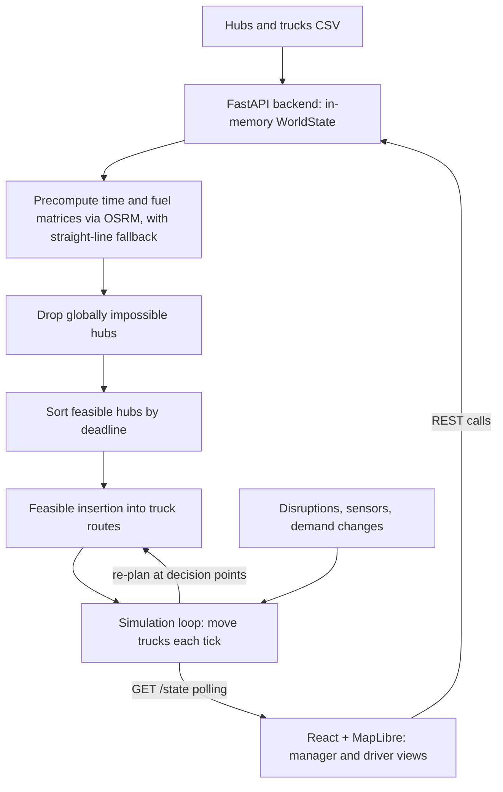

# OptiFlow: Dynamic Route Optimization System (DRO)

A real-time logistics simulator and dispatcher for a central-depot truck fleet. Trucks are assigned delivery hubs under hard deadline, driving-time and fuel constraints, and the plan is re-evaluated live when demand changes or disruptions (rain, traffic, roadblocks, disasters) occur.

**Links:** [GitHub](https://github.com/shriram-s7/DYNAMIC-ROUTE-OPTIMIZATION-SYSTEM) · [Demo video](https://youtu.be/uunL2gQFaAw) · Successor project: [diary-flow (DairyFlow)](https://github.com/shriram-s7/diary-flow), which grew out of this system

## Overview

Delivery fleets rarely run the plan they started with. A road closes, rain slows traffic, or a hub suddenly needs more stock. DRO models a depot (the "Trichy Central Depot" in `backend/main.py`) serving many hubs with a limited fleet, and keeps assigning and re-ordering work as conditions change. Managers watch a live map and can steer individual trucks; drivers get a separate view with their queue and manager instructions.

All decisions are **rule-based and heuristic**. There is no machine learning model in this repository.

## Features

**Manager view**
- Upload hubs and trucks as CSV, or add hubs manually or at random.
- Start, pause, resume, stop, reset and speed up the simulation.
- Live map (MapLibre GL) of trucks, hubs and routes; per-truck status, fuel and queue.
- Inject disruptions: weather and traffic sensors, disasters and roadblocks; override a blocked truck.
- Edit a hub's demand or intensity mid-run and watch the plan react.
- Send an instruction to a specific truck.

**Driver view** (`frontend/driver.html`)
- Current task, queued hubs and manager instructions with acknowledgement.

**Engine**
- Deadline-constrained assignment (maximise hubs served, then minimise fuel), documented in [`ALGORITHM_DESIGN.md`](ALGORITHM_DESIGN.md).
- Re-planning at safe decision points, hub ownership states (unassigned, assigned, completed) and demand-escalation handling.

## How it works



The core algorithm (see `ALGORITHM_DESIGN.md`) is **Deadline-First Feasible Insertion**: hubs that cannot be reached within the 7.5 h driving limit, their deadline, or any truck's fuel range are set aside; the rest are processed in deadline order and inserted into the route where they remain feasible. Road geometry comes from the public OSRM demo server (`router.project-osrm.org`) when reachable, otherwise straight-line interpolation.

## Tech stack

| Layer | Technology |
|---|---|
| Backend | Python, FastAPI, Uvicorn, Pydantic |
| Routing data | OSRM public API (`requests`), haversine fallback |
| Frontend | React, React Router, Axios, Vite |
| Map | MapLibre GL JS |
| State | In-memory (lost on restart) |

## Project structure

```text
backend/
  main.py                          FastAPI app, world state, simulation loop, REST API
  route_assignment_algorithm.py    deadline-constrained assignment
  deterministic_assignment_algorithm.md, README.md
frontend/
  src/App.jsx, DriverApp.jsx ...   manager and driver React apps
  index.html, driver.html          two entry pages
sample_data/trucks.csv             example fleet
ALGORITHM_DESIGN.md, docs/         algorithm and system design notes
media/                             demo video
```

## Getting started

Prerequisites: Python 3.10+ and Node.js 18+. No environment variables or secrets are needed. Internet access is optional (OSRM routes only).

**Windows (PowerShell)**

```powershell
cd backend
python -m venv .venv
.\.venv\Scripts\Activate.ps1
pip install -r requirements.txt
python main.py          # http://localhost:8000
```

```powershell
cd frontend
npm install
npm run dev             # http://localhost:3000
```

**Linux / macOS**

```bash
cd backend && python3 -m venv .venv && source .venv/bin/activate
pip install -r requirements.txt && python main.py
# in a second terminal
cd frontend && npm install && npm run dev
```

## Usage

1. Open http://localhost:3000.
2. Upload a **Hubs CSV** and `sample_data/trucks.csv` (a hubs sample is not included in this repository; see below), or add hubs manually/randomly.
3. Press **Start**, then toggle disruptions and edit hub demand to watch trucks re-plan.
4. Open `http://localhost:3000/driver.html` for the driver's view.

CSV columns: hubs need `id,name,latitude,longitude,demand_quantity` (optional `availability,demand_intensity,deadline_hours`); trucks use `id,fuel_capacity,cost_per_km,max_deliveries,speed_kmph,mileage_kmpl,active`, as in `sample_data/trucks.csv`.

## Tests

There is no automated test suite in this repository.

## Status and limitations

- Working prototype; state is a single in-memory object, so there is no persistence or multi-user safety.
- Decision-making is rule-based. The "AI" wording in the older design docs refers to these heuristics.
- `docs/SETUP.md` mentions `sample_data/hubs.csv`, which is not committed; supply your own hubs CSV.
- Depends on the public OSRM demo server for road geometry, with a straight-line fallback.
- The frontend has no tests, and the backend has no authentication.
- The later [DairyFlow](https://github.com/shriram-s7/diary-flow) project continues this work.

## License

No license specified.
